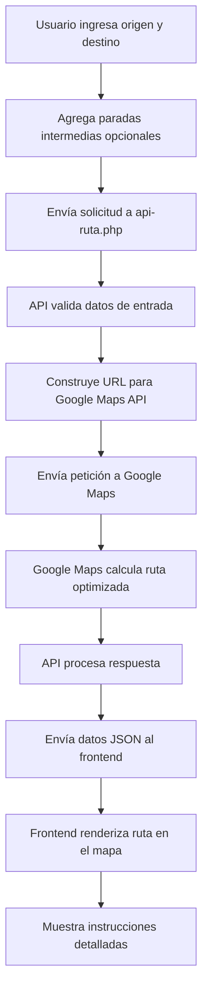

# 🚛 Sistema de Rutas Optimizadas para Residuos

## 📋 Descripción General

Este proyecto implementa un sistema completo de gestión de rutas optimizadas para la recolección de residuos utilizando **PHP Orientado a Objetos** y **Google Maps API**. El sistema permite calcular rutas eficientes con paradas intermedias, optimizando el recorrido de los camiones de residuos.

## 🏗️ Arquitectura del Sistema

### Archivos Principales

#### 1. `api-ruta.php` - Backend API
**Ubicación:** `Ejemplo2RutasOp/clases/api-ruta.php`

**Funcionalidad:**
- **API REST** que procesa solicitudes de cálculo de rutas
- Integración con **Google Maps Directions API**
- Validación de datos de entrada
- Manejo de errores y respuestas JSON
- Optimización automática de paradas intermedias

**Características técnicas:**
- Solo acepta peticiones POST
- Validación estricta de parámetros obligatorios
- Manejo de errores de Google Maps API
- Respuestas en formato JSON
- Optimización de waypoints con `optimize:true`

#### 2. `index.php` - Frontend Interactivo
**Ubicación:** `Ejemplo2RutasOp/clases/index.php`

**Funcionalidad:**
- Integración con **Google Maps JavaScript API**
- Autocompletado de direcciones con **Google Places API**
- Gestión dinámica de paradas intermedias
- Visualización de rutas en tiempo real

**Características técnicas:**
- Autocompletado inteligente de direcciones
- Gestión de estado con JavaScript
- Notificaciones en tiempo real
- Integración completa con Google Maps


## 🔧 Tecnologías Utilizadas

### Backend
- **PHP 8.0+** con características modernas
- **Google Maps Directions API** para cálculo de rutas
- **JSON** para intercambio de datos
- **HTTP REST** para comunicación

### Frontend
- **HTML5** semántico
- **CSS3** con Grid, Flexbox y animaciones
- **JavaScript ES6+** con async/await
- **Google Maps JavaScript API**
- **Google Places API** para autocompletado

## 📊 Flujo de Funcionamiento



## 🚀 Instalación y Configuración

### Requisitos Previos
- Servidor web (Apache/Nginx)
- PHP 8.0 o superior
- Clave de API de Google Maps con las siguientes APIs habilitadas:
  - Maps JavaScript API
  - Places API
  - Directions API

### Pasos de Instalación

1. **Clonar o descargar** los archivos del proyecto
2. **Configurar la clave de API** en ambos archivos:
   ```php
   // En api-ruta.php línea 10
   define('CLAVE_API_GOOGLE_MAPS', 'TU_CLAVE_AQUI');
   
   // En index.php línea 4
   define('GOOGLE_MAPS_API_KEY', 'TU_CLAVE_AQUI');
   ```
3. **Subir archivos** al servidor web
4. **Acceder** a `index.php` desde el navegador

## 📱 Características del Sistema

### ✅ Funcionalidades Implementadas
- ✅ Cálculo de rutas optimizadas
- ✅ Paradas intermedias dinámicas
- ✅ Autocompletado de direcciones
- ✅ Interfaz responsive
- ✅ Validación de datos
- ✅ Manejo de errores
- ✅ Visualización en mapa interactivo

```

## 🔒 Consideraciones de Seguridad

### Pendiente
- 🔄 Autenticación de usuarios
- 🔄 Autorización por roles
- 🔄 Logs de auditoría
- 🔄 Encriptación de datos sensibles


## 🤝 Contribución

### Cómo Contribuir
1. Fork del repositorio
2. Crear rama de feature
3. Implementar cambios
4. Ejecutar tests
5. Crear Pull Request

### Estándares de Código
- PSR-12 para PHP
- ESLint para JavaScript
- Prettier para CSS
- Documentación en español

